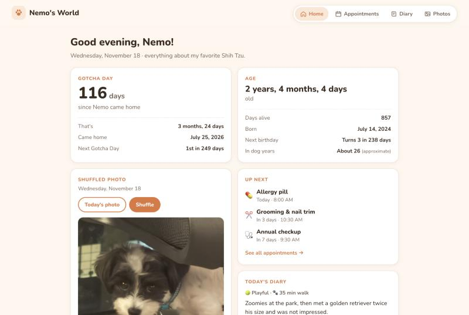
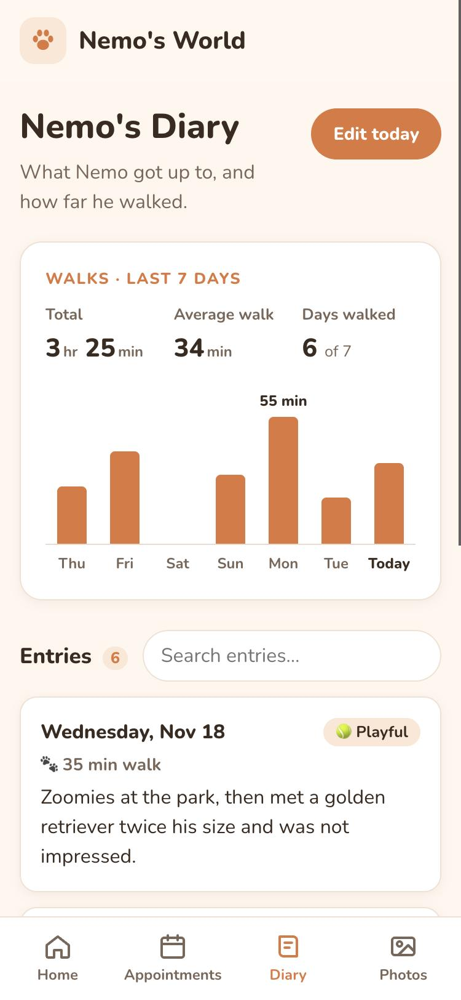

# 🐾 Nemo's World

A small, friendly web app about my two-year-old Shih Tzu, **Nemo**. It keeps track of
how long he's been home, how old he is, his vet visits and medication, a daily photo,
and a diary of what he got up to.

I built it as part of my AI project portfolio: I wrote the product spec and directed
[Claude Code](https://claude.com/claude-code) through building it phase by phase,
reviewing and testing each step.

**Live demo:** [nemos-world.vercel.app](https://nemos-world.vercel.app)

<p>
  
  &nbsp;
  
</p>

<sub>Screenshots use sample appointments and diary entries.</sub>

## Features

- **Gotcha Day counter**: days since Nemo came home, broken into years, months and
  days, with a countdown to his next anniversary and a celebration (banner and
  confetti) on the day itself.
- **Age tracker**: Nemo's age down to the day, total days alive, a countdown to his
  next birthday, and an approximate age in dog years.
- **Appointments & medication**: add, edit and delete vet visits, grooming,
  vaccinations and medication, with an optional time and notes.
  - Medication can repeat daily, weekly or monthly. Ticking a dose off schedules
    the next one, skipping past missed doses so they don't pile up, and keeps
    monthly doses on the right day (Jan 31 → Feb 28 → Mar 31).
  - Items are grouped into **Overdue**, **Today**, **Upcoming** and **Done**, and
    can be filtered by category.
- **Picture of the Day**: a new photo of Nemo every day. It goes through every photo
  before repeating, never shows the same one two days in a row, and has a
  **Shuffle** button. Photos are picked up automatically from a folder and resized
  at build time.
- **Photo gallery**: tap any photo under **All photos** to open it full screen, then
  swipe, use the ‹ › buttons or the arrow keys to move through them.
- **Nemo at Daycare**: one-tap links to the webcams at both of Nemo's daycare
  locations (NoMa and Rosslyn), which open on the daycare's website.
- **Nemo's Diary**: one entry per day with what Nemo did, how long he walked and his
  mood. Includes keyword search, walk stats and a 7-day walk chart.
- **Home dashboard** that brings it all together.
- **Installs and works offline**: add it to a phone's home screen and it opens in its
  own window with a paw-print icon, and keeps working with no internet connection.
- Works on phones and desktops, in light and dark mode, with keyboard and
  screen-reader support.

## Tech stack

| | |
|---|---|
| UI | React 18, TypeScript, React Router |
| Build | Vite, with [vite-imagetools](https://github.com/JonasKruckenberg/imagetools) to resize photos to WebP |
| Dates | date-fns |
| Tests | Vitest |
| Styling | Plain CSS with design tokens and automatic dark mode; Nunito font bundled with the app |
| Data | Saved on the device (`localStorage`); no backend, login, AI service or API keys |
| Offline | A small hand-written service worker ([`src/service-worker.js`](src/service-worker.js)) |

## How it's built

- **The rules are pure functions, separate from the UI.** All date math (ages,
  anniversaries, repeating doses, which photo to show today) lives in
  [`src/lib/dates.ts`](src/lib/dates.ts). The appointment and diary rules live in
  [`appointments.ts`](src/lib/appointments.ts) and [`diary.ts`](src/lib/diary.ts).
  None of them read the clock or touch the page, which makes them easy to test.
- **Tested edge cases.** 72 unit tests cover leap days (a Feb 29 birthday is
  celebrated on Feb 28 in other years), month ends, the day before, of and after an
  anniversary, and late-night times. The tests pass in several time zones.
- **One storage module.** Everything saved goes through
  [`src/lib/storage.ts`](src/lib/storage.ts), so switching to a real database later
  means changing one file.
- **Fast photos.** Each photo is resized to 480 px and 960 px WebP versions at build
  time, and loads only when it scrolls into view.
- **Works offline.** When the app is first opened, a service worker saves the page,
  code, styles, font and icons on the device (about 475 KB). After that the app opens
  with no connection, and diary entries and appointments save as normal. Photos are
  saved as they're viewed; one that hasn't been seen yet shows a "back online"
  placeholder. The build fills in the exact file list
  ([`scripts/service-worker-build.ts`](scripts/service-worker-build.ts)), so phones
  pick up updates automatically. Tested by switching off the server and the network
  in Chrome.

```
src/
  pages/        One component per screen (Home, Appointments, Diary, Photos)
  components/   Cards, forms, the walk chart, navigation
  lib/          Pure logic and tests, storage, and small React hooks
  assets/nemo/  Photos of Nemo (any JPG, PNG or WebP dropped here is used)
```

## Running it locally

You'll need [Node.js](https://nodejs.org) 22 or newer.

```bash
npm install
npm run dev        # start the app at http://localhost:5173
npm test           # run the unit tests
npm run build      # build the production site into dist/
```

**Adding photos:** drop JPG, PNG or WebP files into `src/assets/nemo/`. A descriptive
file name like `first-bath.jpg` becomes the caption "First bath"; camera names like
`IMG_1234.JPG` get no caption. (iPhone HEIC photos need to be exported as JPEG
first.)

**App icon:** the paw-print home-screen icons in `public/` are generated by
`node scripts/make-icons.mjs`; edit the colors or shape there and run it again.
On a phone, open the site and choose **Add to Home Screen** to use it like an app.

**Previewing a different day:** while running `npm run dev`, add `?date=YYYY-MM-DD`
to the address, for example `http://localhost:5173/?date=2027-07-25`, to see the
Gotcha Day celebration. This only works in development.

## How I built this with AI

<!--
  Write this section in your own words. Some questions to answer:
  - Why did you build Nemo's World, and why with AI?
  - How did you write the spec (SPEC.md), and how did it shape the result?
  - How did you work with Claude Code phase by phase? What did you review or test
    yourself before approving each phase?
  - What did you change or push back on along the way?
  - What did you learn about directing an AI coding tool?
-->

_To be written._

The original product spec I gave Claude Code is in [SPEC.md](SPEC.md).
